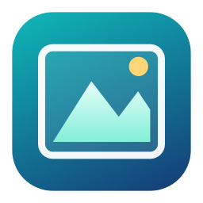

# 轻览 LightLook



[下载最新安装包](https://github.com/SamonCloud/lightlook/releases/latest) · [版本发布记录](https://github.com/SamonCloud/lightlook/releases)

轻览是一个直接浏览文件夹的 macOS 原生图片与视频查看器。它采用 Swift、AppKit、Image I/O、AVKit、MapKit 和 Network.framework，不依赖 Electron、浏览器运行时、数据库或第三方解码库。当前版本为可运行的 0.2.0 原型，面向本机使用。

## 打开应用

DMG 安装镜像位于 `build/轻览-0.2.0-macOS-arm64.dmg`，打开后将“轻览.app”拖入 Applications 即可安装。

本次新版应用位于 `build/releases/0.2.0/轻览.app`，可以直接双击，也可以复制到自己的“应用程序”目录。程序坞和 Finder 使用蓝绿色相框与山形 Logo，图标由 `Tools/Icon.swift` 生成。应用启动时会明确加载图标。

当前构建面向 Apple Silicon；源码最低部署目标为 macOS 13，实际验证环境为 macOS 27.0.1。本版本使用本机临时签名，尚未进行 Apple Developer ID 签名和公证。

打开后点击左上角文件夹按钮选择目录。浏览和打标签不改写图片内容，也不导入图库；文件复制、移动和废纸篓处理只在您发起批处理后执行；文件夹内容变化后按 `⌘R` 刷新。

```sh
LIGHTLOOK_APP_DIR="$PWD/build/releases/0.2.0/轻览.app" zsh build.sh
open build/releases/0.2.0/轻览.app
# 指定一个目录或图片：
open build/releases/0.2.0/轻览.app --args "/你的图片目录"
```

上下键在主窗口缩略图模式按实际布局移动到相邻行，并尽量保持同一列；选中项超出可见范围时，浏览区域自动向下或向上滚动，使其显示在窗口内；末行没有对应列时选择最近的一张，返回上一行时保留原列。调整窗口宽度、分栏或缩略图大小后自动按新布局计算。列表和全屏模式的方向键操作不变。

构建需要 macOS 和 Xcode Command Line Tools，不需要安装额外软件包。`build.sh` 根据当前机器架构编译。

## 当前功能

| 要求 | 当前实现 |
| --- | --- |
| 三栏浏览 | 左侧目录树；中间缩略图或文件名列表；右侧预览和元数据。三栏宽度可以拖动调整。 |
| 文件浏览 | 文件名搜索、名称正序/倒序、修改时间和大小排序，缩略图大小调节，文件夹上一级导航。目录只扫描当前一层。 |
| 标签与文件操作 | 跨目录“已选择/待删除”标签，主窗口与全屏快捷键，复制、移动及二次确认后移到系统废纸篓。 |
| 元数据 | 拍摄时间、GPS 坐标及可选的联网地名/小地图、相机品牌/型号、镜头品牌/型号、光圈、快门、焦距、ISO、分辨率、文件大小，并提供格式、视频时长、修改时间及路径。缺失值显示为“—”。 |
| 自定义元数据 | 右侧滑杆按钮或 `⌘,` 打开设置，勾选显示字段，选中行后上移/下移，再保存。配置保存在当前用户的应用偏好中。自定义的是字段显示和排序，不是改写照片的 EXIF。 |
| 图片查看 | 空格进入全屏，方向键换图，原尺寸/适应切换，放大后拖动、滚动或方向键平移；读取 EXIF 方向信息。 |
| 图片格式 | JPG/JPEG、HEIC/HEIF、PNG、TIFF、GIF、BMP、WebP、AVIF 等由系统 Image I/O 解码的格式。GIF 当前只显示静态首帧。 |
| 相机 RAW | ARW、DNG、CR2、CR3、NEF、NRW、RAF、ORF、RW2、PEF、RWL 等通过系统 Image I/O 解码。已实测 Sony ILCE-7S ARW 和 Canon EOS 5D Mark III 转换的 DNG；其他机型和压缩模式尚未逐一验证。 |
| 视频 | MP4、M4V、MOV 使用 AVKit 播放，带播放进度、音量和系统支持的外部播放入口。实际编解码兼容性取决于 macOS。 |
| DLNA 投屏 | 搜索同网段 UPnP AV MediaRenderer，或手动输入设备描述 XML 地址；发送当前照片或 MP4/M4V，支持停止投屏。照片转为最大边 3840 像素的 JPEG；视频原样传输，不自动转码。 |

## 键盘与鼠标

| 操作 | 功能 |
| --- | --- |
| `⌘O` / `⌘R` | 打开目录 / 刷新 |
| 空格 / `Esc` | 进入全屏 / 退出全屏；图片全屏时再次按空格也可退出 |
| 主窗口缩略图：`←` / `→` | 上一张 / 下一张 |
| 主窗口缩略图：`↑` / `↓` | 上一行 / 下一行，尽量保持同一列 |
| 列表及全屏：`←`、`↑` / `→`、`↓` | 上一张 / 下一张 |
| `S` | 切换“已选择”标签 |
| `D` / Delete | 切换“待删除”标签，不立即删除文件 |
| `F` | 图片全屏时切换 100% / 适应窗口 |
| `1` / `0` | 仅在图片全屏时切换 100% / 适应窗口 |
| 放大后的方向键、滚动、鼠标拖动 | 平移查看细节 |
| `⌥` + 方向键 | 放大时切换文件 |
| 双击全屏图片 / 双击缩略图 | 切换 100% 与适应 / 进入全屏 |
| 视频全屏中的空格 | 播放 / 暂停 |
| `⌘,` | 自定义元数据 |

图片全屏时，右下角默认显示 11 点、半透明白色的元数据，带轻微文字阴影。显示字段和顺序沿用右侧元数据设置；换图时自动更新。底部“显示元数据”开关可以控制显隐，应用会记住选择。文字覆盖区域不会阻挡图片拖动，视频播放时不显示此覆盖层。

主窗口右侧图片预览固定为自适应大小，不响应 `1`、`0`、双击或捏合缩放；需要检查原尺寸细节时进入全屏。

100% 按屏幕物理像素定义：一个图像像素对应一个屏幕像素。在 Retina 屏幕上，它与图像的点尺寸不同。原尺寸解码按需执行，仅保留当前文件；缩略图缓存的建议上限为 96 MiB，NSCache 由系统回收，这不是整个进程内存的硬上限。高分辨率 RAW 原尺寸查看和视频播放会增加内存占用。

## 标签复核与文件操作

左侧目录树下方提供“已选择”和“待删除”两个标签列表，显示跨目录的记录总数。

- 在主窗口或全屏查看时，按 `S` 切换“已选择”，按 `D`、Delete 或前向 Delete 切换“待删除”；再次按同一键取消。按住按键不会连续反复切换。搜索框、文字输入和确认弹窗不会误触发标签。
- 缩略图角标、文件名列表的“标签”列及全屏左上角都会显示标签。两个标签彼此独立，可以同时存在；标签与图片原始文件分开保存，不写入 Finder 标签或 XMP。
- 点击“已选择”，可集中复核所有相关文件；在这里按 `S` 取消当前项后，会继续显示相邻的一张。上方“批处理”提供“全部取消标签”“全部复制到…”和“全部移动到…”。取消全部仅清除“已选择”，保留其他标签。
- 点击“待删除”复核；按 `D` 或 Delete 只取消标签，不删除文件。该列表的批处理仅提供“确认删除…”，再经第二次确认后才调用系统废纸篓。确认窗口会列出完整文件清单，默认按钮为“取消”。不提供永久删除或自动清空废纸篓。
- 所有批处理都针对该标签的全部文件，包括其他目录和搜索暂未显示的项目。复制、移动会弹窗选择目标文件夹，同名目标使用 `文件名 (1).扩展名` 等编号，不覆盖已有内容。
- 复制成功后，原文件保留标签，新增副本不自动打标签；移动成功后，原有的两个标签跟随目标路径。移到废纸篓成功的项目从两个标签列表移除。失败和未处理项保留标签，并在结果窗口列出原因。

标签保存在 `~/Library/Application Support/LightLook/tags.json`，原子写入并在重启后恢复。批处理结果保存在同目录 `Batches/`，可在启动时重放已记录成功项的标签变更；这些日志用于恢复标签，不会在启动时自动执行移动或删除。批处理进行中可继续浏览，但暂时不能改标签、发起另一批次或正常退出，避免遗漏结果。

离线磁盘或找不到的文件不会被自动从标签记录移除；可在标签列表取消旧标签。系统文件身份检查会拒绝操作被替换到同一路径的新文件。当前不自动跟踪应用外的重命名和移动，发生后请取消旧记录并在新位置重新标记。遇到目标路径已有失效旧标签的情况，会保留日志并提示清除旧标签后刷新恢复，避免新文件继承旧的“待删除”状态。

标签按单个文件管理，RAW/JPG、Live Photo 的照片与视频及同名侧车不会自动成组处理。复制和跨卷移动按块校验 SHA-256；无法移动到系统废纸篓时只报告失败，不回退为永久删除。

## 地点与小地图

在右侧元数据下方找到“地点与地图”，开启“联网地点与地图”。该开关默认关闭，开启前界面会说明：所选照片的坐标将发送至 Apple 地图服务，照片文件不会上传。开启后，带 GPS 的照片会自动查询大致地名，并显示标记坐标的小地图，可拖动和缩放；关闭开关后停止新查询并移除地图。开关会记住选择。

右侧“拍摄地点”和全屏元数据会显示查询得到的地名，同时保留原始坐标。切换图片时延迟 0.7 秒再查询，取消旧请求，避免结果串到另一张图片；本次运行中最多缓存 128 个成功地名结果，不另建持久化地点数据库。地图自身的缓存由系统管理。支持标准照片 GPS 和常见 ISO 6709 视频坐标。

没有 GPS 时显示“此文件没有可用的 GPS 坐标”。网络不可用或查询失败时保留原始坐标，可点击重新查询。地名是地图服务根据坐标提供的参考描述，不代表已核实实际拍摄地点。该功能不使用电脑的实时定位，不会要求获取当前位置。

## 投屏使用

1. 将电脑和电视连接到同一局域网，并在电视上开启 DLNA/媒体接收功能。
2. 在轻览中选中照片或 MP4，点击顶部电视按钮，选择“搜索 DLNA 电视…”。首次使用时，macOS 可能要求授予局域网权限。
3. 选择设备并播放。若网络阻止多播发现，可以使用电视提供的 UPnP 设备描述 XML 地址手动连接。
4. 切换到另一文件后，需要再次选择投屏。结束时选择“停止投屏并关闭共享”。退出应用也会关闭本机共享服务。

投屏期间，本机临时开放一个随机 TCP 端口，电视通过随机路径读取当前所选媒体，不共享整个文件夹。照片临时 JPEG 在正常退出时删除。DLNA 通信使用局域网 HTTP，不包含 TLS 或接收端身份认证，适用于可信的家庭/办公局域网。视频支持 HTTP HEAD 和字节范围请求，不会一次将整段视频读入内存。

DLNA 已通过本机模拟电视测试，包括多播发现、设备描述解析、SOAP 播放命令及媒体读取；尚未在真实电视上完成兼容性验收。仅支持 AirPlay、Chromecast 或 Miracast 的电视不一定接受 DLNA。AVKit 的系统外部播放入口可在支持时提供视频 AirPlay；本程序没有实现 Chromecast、Miracast 或照片 AirPlay 发送器。MP4 内部编码、音轨或电视照片服务能力不兼容时，可能需要电视侧设置或后续增加转码。

## 兼容性边界

- RAW 支持按相机机型和压缩模式区分，不能仅根据 `.arw`、`.dng` 扩展名判断。当前版本没有捆绑 LibRaw；系统无法解码时显示错误，不把通用图片图标当成成功读取。
- GPS 保留文件记录的经纬度；可在“地点与地图”开启联网查询，显示 Apple 返回的大致地名与小地图。文件没有 GPS 时无法仅凭图片确定拍摄地点。拍摄时间按文件原始值显示；原始 EXIF 未提供时区时，不推断时区。不会用修改时间冒充拍摄时间。
- 镜头品牌只读取文件中的标准 EXIF 字段；没有记录时保留为空，不根据型号推测。厂商私有 MakerNote、XMP 侧车和 Adobe 调色参数尚未解析。
- 当前不包含编辑、评级、批量改名、自动幻灯片、递归索引及 RAW+JPG 合并显示。目录树在展开时读取直接子目录；网络目录很大时仍可能短暂等待。
- 本版本不监控文件夹变更，需手动刷新。不改写图像内容；文件位置仅按您发起的批处理改变，不改变系统默认图片应用。

## 验证与源代码

[验证说明](docs/VALIDATION.md)记录已完成的验证和仍需在真实设备上确认的内容。

```sh
zsh test.sh
zsh test-navigation.sh
zsh test-file-actions.sh
zsh test-tags-ui.sh
zsh test-location.sh
# 可选：使用合成坐标联机验证 Apple 地名服务：
zsh test-location.sh --lookup
python3 Tests/network_test.py
# 使用实际相机样本，读取缩略图、原尺寸和元数据：
build/media-tests --inspect "/路径/照片.ARW" "/路径/照片.DNG"
```

测试会在 `build/测试素材` 生成合成图片；网络测试还需要其中的 `05-视频测试.mp4`。可使用任意 MP4 复制到此测试路径。HEIF 生成需要系统编码服务；在受限执行沙箱中可能失败，正常桌面终端可运行。网络测试会临时监听本机端口并发送 SSDP 多播，结束后关闭测试服务。

主要文件：`Sources/Browser.swift`（浏览界面和交互）、`Media.swift`（文件和元数据、解码）、`Canvas.swift`（图片视图和缩略图）、`Settings.swift`（元数据设置）、`Casting.swift`（DLNA 和媒体 HTTP）、`main.swift`（应用入口）、`Location.swift`（坐标解析与地名服务）、`LocationPanel.swift`（地点面板和地图）、`GridNavigation.swift`（缩略图按行导航）、`CollectionViewport.swift`（选中缩略图的自动滚动）、`FileTags.swift`（持久化标签）、`FileBatch.swift`（文件操作与结果日志）、`TaggingUI.swift`（复核与批处理界面）。

参考：

- [Apple MapKit 地图视图](https://developer.apple.com/documentation/mapkit/mkmapview)
- [Apple Image I/O：图片、缩略图与元数据](https://developer.apple.com/documentation/imageio/cgimagesource)
- [Apple 相机 RAW 支持说明与机型清单](https://support.apple.com/en-nz/122870)
- [UPnP AVTransport 服务规范](https://upnp.org/specs/av/UPnP-av-AVTransport-v3-Service.pdf)
- [公开 RAW 样本库 raw.pixls.us](https://raw.pixls.us/)，本次选用 CC0 样本，仅用于本地兼容性测试。
